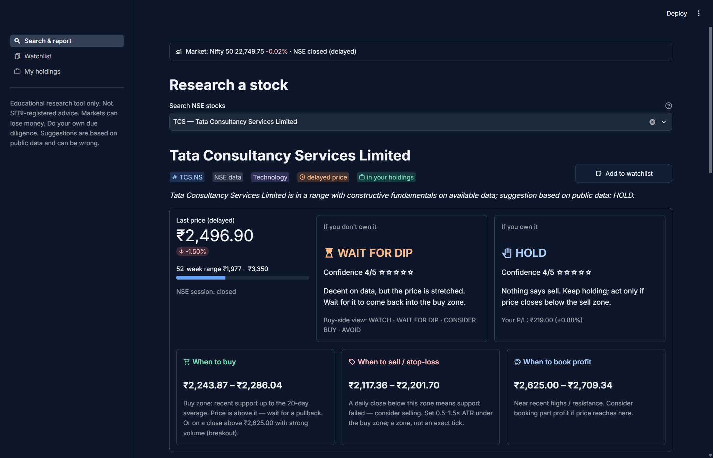
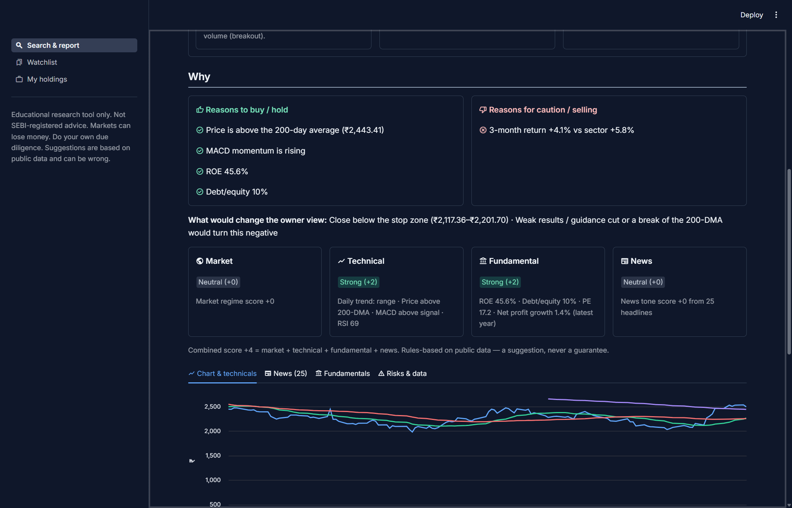
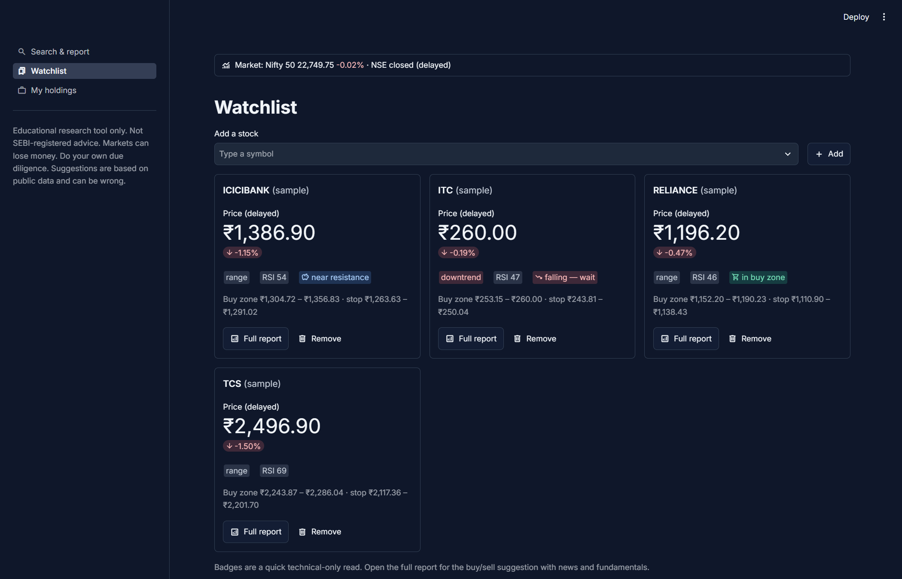
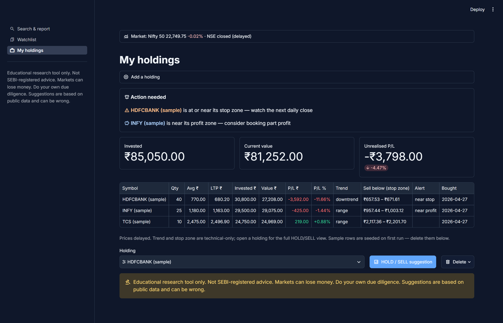
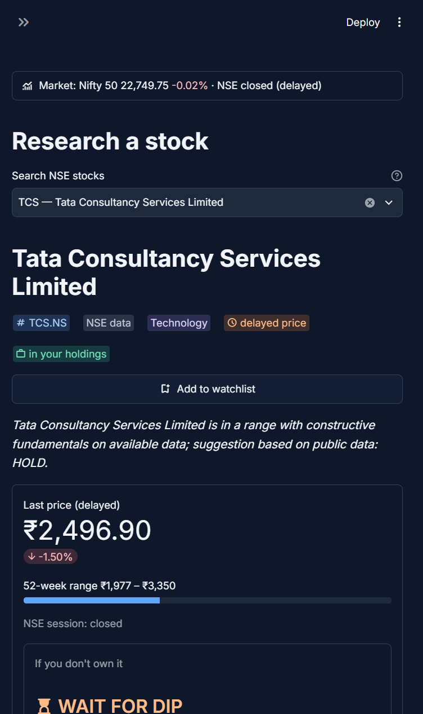

# BharatStock Advisor

**A free, open-source research tool for Indian stocks (NSE and BSE) that runs on your own computer.**

Type a stock name or symbol. The app gathers delayed prices, Indian market news, technicals and fundamentals, then shows plainly:

- **If you don't own it:** WATCH, WAIT FOR DIP, CONSIDER BUY or AVOID
- **If you own it:** ACCUMULATE, HOLD, TRIM, EXIT or WAIT, with your P/L
- **When to buy, when to sell (stop-loss) and when to book profit**, as price zones
- **Why**, with the reasons for and against listed under the verdict

> **Educational research tool only. Not SEBI-registered advice.** Markets can lose money. Do your own due diligence. Suggestions are based on public data and can be wrong.

It never places trades and has no broker connection. It never makes up a number: if data is missing, it says "unavailable".



## Screenshots

### The reasons behind every verdict
Reasons for and against, what would change the view, and a scorecard for the market, technicals, fundamentals and news.



### Watchlist
Cards with trend, RSI, the buy zone and stop zone. Badges show "in buy zone", "near resistance" and "falling — wait".



### My holdings
Live P/L, a "Sell below" stop zone per holding, and an **Action needed** box for anything near its stop or profit zone.



### Works on a phone



*All screenshots use the built-in sample data.*

## Features

- **Type-ahead search** over every NSE-listed stock, plus BSE-only stocks by symbol (for example `SAMKRG.BO`)
- **Two verdicts with confidence (1–5):** one for buyers, one for owners
- **Three price zones:** buy zone, stop-loss zone and profit zone, as ranges rather than exact ticks
- **"Why the verdict changed"** note when a stock's view moves between visits
- **News** from Indian RSS feeds, with a bullish or bearish tag per headline
- **Charts** with the 20, 50 and 200-day averages, plus RSI, MACD, ATR, volume and support/resistance
- **Fundamentals:** ROE, debt/equity, PE and profit growth
- **Market context:** Nifty 50, Sensex, Nifty Bank, India VIX, USD/INR and the stock's sector index
- **Indian formatting:** ₹ with lakh/crore grouping (₹1,23,45,678.90) and IST times
- **Local and private:** your holdings and watchlist stay in a SQLite file on your computer

## Install

You need **Python 3.10+** (from python.org; on Windows, the Microsoft Store "python" stub will not work).

```bash
git clone https://github.com/psparihar21/bharatstock-advisor.git
cd bharatstock-advisor
python -m venv .venv
```

Activate the environment. On Windows use `.venv\Scripts\activate`; on macOS or Linux use `source .venv/bin/activate`. Then:

```bash
pip install -r requirements.txt
python test_core.py          # offline self-check, prints "all checks passed"
streamlit run app.py
```

The app opens at **http://localhost:8501**. It starts with sample holdings and a sample watchlist, which you can delete.

**Optional:** copy `.env.example` to `.env` to add NewsAPI or GNews keys and NSE holiday dates. The app works without them.

## How the suggestion works

There are four scored parts:

| Part | What it looks at |
|---|---|
| Market | Nifty 50 vs its 50-day average, and India VIX |
| Technical | Trend, price vs the 200-day average, MACD |
| Fundamental | ROE, debt/equity, PE, profit growth |
| News | The share of bullish vs bearish headlines |

The scores are added up, and the total maps to an action. An overbought stock (high RSI, or far above its 20-day average) gets WAIT FOR DIP instead of CONSIDER BUY.

**Zones:**
- **Buy zone:** from recent support up to the 20-day average.
- **Stop-loss zone:** 0.5–1.5 ATR below the buy zone. A daily close below it means support failed.
- **Profit zone:** near recent highs and resistance.

A stock in a downtrend is never shown as "in buy zone". Confidence depends on how much data is present and how much the four parts agree. It is capped at 4/5 on purpose, and at 2/5 for new listings with too little price history.

These are simple rules on public data. They have **not been backtested**.

## Data sources

Only public RSS feeds and documented APIs are used. Nothing is scraped.

- **Prices and ratios:** Yahoo Finance via [`yfinance`](https://github.com/ranaroussi/yfinance), using `.NS` and `.BO` symbols. Prices are **delayed** (about 15 minutes). Results are cached and calls are throttled.
- **Stock list:** NSE's public `EQUITY_L.csv`.
- **News:** Google News India RSS, plus the ET Markets, Livemint, Business Standard and Moneycontrol RSS feeds. NewsAPI and GNews are used only if you add keys. If every feed fails, recent cached news is used, and prices and technicals still work.

## Files

| File | What it does |
|---|---|
| `app.py` | Streamlit UI: Search & report, Watchlist, My holdings |
| `core.py` | Data, indicators, scoring, zones and SQLite, with no UI code |
| `test_core.py` | Offline checks for formatting, market hours, indicators, zones and suggestions |
| `.env.example` | Optional API keys and settings |
| `bharatstock.db` | Created on first run; it holds your holdings and watchlist and is never committed |

## Limits

- Prices are delayed, not real-time, and Yahoo ratios can lag the latest quarter.
- FII/DII flows and promoter pledge are **not available** from free documented sources.
- News sentiment uses keyword rules, not a model. Treat it as a rough gauge.
- There is no peer comparison yet.
- NSE holidays only work if you list them in `.env`. Weekends are handled automatically.

## Built with

[Streamlit](https://streamlit.io), [yfinance](https://github.com/ranaroussi/yfinance), [pandas](https://pandas.pydata.org) and [feedparser](https://github.com/kurtmckee/feedparser).

---

**Disclaimer:** This is an educational research tool only. It is not SEBI-registered investment advice. Markets can lose money. Do your own due diligence. Suggestions are based on public data and can be wrong.
